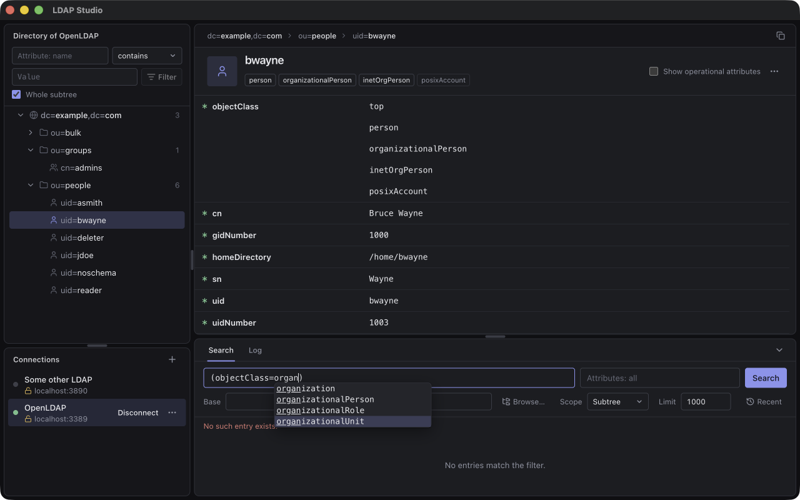

# LDAP Studio

A fast, modern desktop LDAP browser and editor, reminiscent of Apache Directory Studio, but built with Electron, React and TypeScript.

> [!IMPORTANT]
> AI-generated code: The majority of the code in this repository was created with AI assistance (Claude Code).



## Features

- **Works with your directory.** OpenLDAP, 389 Directory Server and Active Directory.
- **Connect securely.** LDAPS and StartTLS, certificate verification with the option to trust a specific self-signed certificate, and saved passwords protected by your operating system's secure storage.
- **Browse huge trees.** Expand containers with thousands of entries and scroll smoothly. Filter the tree, jump to any DN, cancel slow loads.
- **Edit with confidence.** Stage changes, review them in a preview, and save them all at once. Schema checks catch mistakes before they reach the server, and you're warned if someone else changed the entry in the meantime.
- **Schema-aware editing.** See which attributes an entry may have, with descriptions for every object class and attribute type.
- **Create, copy, rename, move and delete.** Start a new entry from scratch or from an existing one, and delete whole subtrees with progress shown.
- **Handle any value.** Pick DN values from the tree and follow them with one click, edit multi-line text, view and import/export binary data like photos and certificates, and set hashed passwords in a dedicated dialog.
- **Search fast.** Write filters with live validation and autocomplete, page through large result sets, and reuse recent searches.
- **Stay in flow.** Command palette, keyboard navigation, resizable panes, light and dark themes, and an operation log of everything sent to the server.

## Installation

Download the installer for your platform from the [releases page](https://github.com/soulchild/ldap-studio/releases/latest): a DMG for macOS (Apple Silicon or Intel), an installer for Windows (x64 or Arm64), or an AppImage or `.deb` package for Linux.

> [!NOTE]
> The apps are not signed with a developer certificate, so your operating system may warn you or refuse to open LDAP Studio on first launch. You have to allow it explicitly:
>
> - **macOS:** If macOS says it cannot verify the app, choose Done, then open System Settings → Privacy & Security and click Open Anyway next to the message about LDAP Studio. Alternatively, run `xattr -dr com.apple.quarantine "/Applications/LDAP Studio.app"`.
> - **Windows:** If SmartScreen shows "Windows protected your PC", click More info, then Run anyway.
> - **Linux:** Make the AppImage executable with `chmod +x` before running it.

## Prerequisites

- Node.js 22.12 or newer
- pnpm 11 (`packageManager` in `package.json` pins the version)
- Docker with Compose, for the integration tests only

## Setup

```sh
pnpm install
```

Electron downloads its binary the first time it starts (for example on the first `pnpm dev`). To download it up front, for example in CI, run:

```sh
pnpm exec install-electron
```

On macOS, `pnpm dev` and `pnpm preview` start the app from a renamed copy of Electron's app bundle in `.dev-app/`, so the menu bar, Dock and About panel show "LDAP Studio" and its icon instead of Electron's. The copy is rebuilt when Electron or `build/icon.png` changes. The installed Electron package is left untouched.

## Commands

| Command                  | What it does                                                                                |
| ------------------------ | ------------------------------------------------------------------------------------------- |
| `pnpm dev`               | Start the app in development mode with hot reload                                           |
| `pnpm build`             | Build main, preload and renderer into `out/`                                                |
| `pnpm preview`           | Run the production build                                                                    |
| `pnpm typecheck`         | Type-check the main/preload and renderer projects                                           |
| `pnpm lint`              | Lint, including the curly-brace and import-boundary rules                                   |
| `pnpm format`            | Format all files with Prettier                                                              |
| `pnpm format:check`      | Check formatting without writing                                                            |
| `pnpm test`              | Run the unit tests                                                                          |
| `pnpm test:integration`  | Run the integration tests against the Docker test servers (skipped if they are not running) |
| `pnpm test:env:up`       | Start and seed the Docker test servers (see `test/ldap/README.md`)                          |
| `pnpm test:env:down`     | Stop the test servers and delete their data                                                 |
| `pnpm test:e2e`          | Build, then run the Playwright tests against the app (most need the test servers)           |
| `pnpm dist`              | Build installers for the current platform into `dist/`                                      |
| `pnpm dist:mac`          | Build macOS DMGs (Apple Silicon and Intel)                                                  |
| `pnpm dist:win`          | Build Windows NSIS installers (x64 and Arm64)                                               |
| `pnpm dist:linux`        | Build a Linux AppImage and deb                                                              |
| `pnpm changelog:preview` | Show the changelog entries for the next release                                             |

## Installers

`electron-builder.yml` configures the installers. They are not signed with a developer certificate. Windows SmartScreen shows a warning on first launch.

On macOS the app is signed ad hoc (no Apple Developer account needed), so macOS treats a downloaded copy as coming from an unidentified developer. The first time you open it, macOS says it cannot verify the app; choose Done, then open System Settings → Privacy & Security and click Open Anyway next to the message about LDAP Studio. Alternatively, remove the download flag in a terminal: `xattr -dr com.apple.quarantine "/Applications/LDAP Studio.app"`. Builds you make yourself with `pnpm dist:mac` are not flagged and open directly. Opening without any warning would need a Developer ID certificate and notarization (Apple Developer Program).

Windows and Linux installers can be built on a Mac.

To check a build, `node test/package/launch.mjs <executable>` launches it and waits for the workspace. `sh test/package/linux-check.sh [arm64|amd64]` installs the Linux packages in a clean Debian container and launches them. Chromium does not run under Docker's x86 emulation, so on Apple Silicon only `arm64` works. The release workflow builds, installs and launches the installers on macOS, Windows and Linux runners (see [Releasing](#releasing)).

## Continuous integration

`.github/workflows/ci.yml` checks formatting, lint and types, and runs the unit and integration tests. It builds the installers only for a release (see [Releasing](#releasing)). The end-to-end tests are optional: they run when the workflow is started by hand (with "Run the end-to-end tests" ticked), when a pushed commit message contains `[e2e]`, when a pull request has the label `e2e`, or always if the repository variable `RUN_E2E` is `true`.

## Releasing

Start a release in GitHub under Actions → Release → Run workflow, on `main`, with the new version (for example `1.2.0`; `1.2.0-beta.1` becomes a pre-release). `.github/workflows/release.yml` runs CI with that version and the end-to-end tests (untick "Run the end-to-end tests" to release without them). Only if everything passes does it set the version in `package.json`, write `CHANGELOG.md`, commit both as `chore(release): 1.2.0`, push the commit with the tag `v1.2.0`, and publish a GitHub release with the installers and the version's changelog. If anything fails, nothing is pushed, and you can run it again with the same version.

The changelog is made by [git-cliff](https://git-cliff.org) from the commit messages, which follow [Conventional Commits](https://www.conventionalcommits.org/en/v1.0.0/) (see `AGENTS.md`). It lists `feat` under Added, `fix` under Fixed, `perf` under Performance and `revert` under Reverted, and breaking changes of any type under their own heading. Other types are left out. Commits from before the switch are grouped by their first word (see `cliff.toml`). `pnpm changelog:preview` shows what the next release will list.

The workflow pushes to `main` with the built-in `GITHUB_TOKEN`. If `main` is protected, allow GitHub Actions to push to it.

## Project layout

```
src/
  main/       Electron main process: window, IPC handlers, LDAP, schema, storage
  preload/    The only bridge between the renderer and main (contextBridge)
  renderer/   React UI (sandboxed: no Node, no network, no file access)
  shared/     Pure TypeScript used by both sides: IPC contract, DN, filter, formatters
```

Lint enforces the boundaries: `src/shared` may not import Electron, Node built-ins or app layers, and the renderer may not import Electron, Node built-ins or main-process code.

## License

[MIT](LICENSE)
